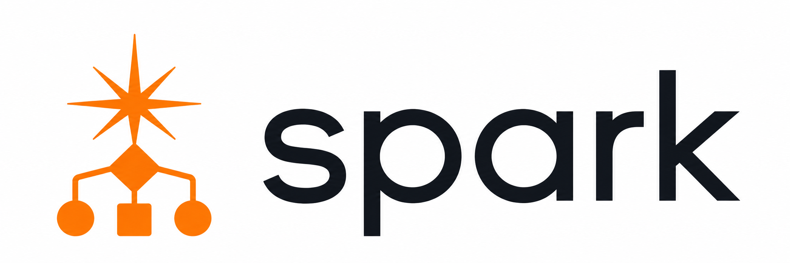
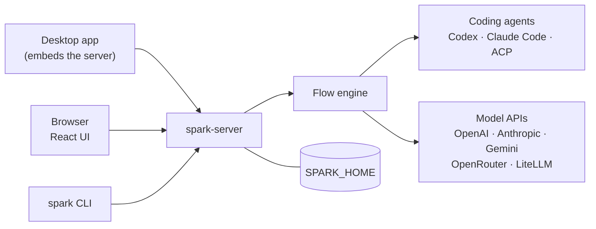

<p align="center">
  <picture>
    <source media="(prefers-color-scheme: dark)" srcset="assets/spark-wordmark-dark-orange-symbol.png">
    
  </picture>
</p>

<p align="center">
  <strong>A workspace workbench for AI-assisted software delivery.</strong><br>
  Talk through the work, launch a flow, and let agents design, implement and review the change.
</p>

<p align="center">
  
  
  
  
</p>

<p align="center">
  <a href="#quick-start">Quick start</a> ·
  <a href="#how-it-fits-together">How it fits together</a> ·
  <a href="#provider-configuration">Providers</a> ·
  <a href="#development">Development</a> ·
  <a href="docs/first-flow-tutorial.md">First flow tutorial</a>
</p>

---

Spark is a Cargo-built workspace workbench for AI-assisted software delivery. It ships the public native command names `spark` and `spark-server`, serves a React UI, and runs markdown-authored flows through Rust crates.

## Highlights

<table>
  <tr>
    <td width="33%" valign="top">
      <h3>💬 Conversation first</h3>
      Work on a project by talking to an assistant that reads the repository and launches flows for you.
    </td>
    <td width="33%" valign="top">
      <h3>🧩 Flows are markdown</h3>
      A flow is a directory with one markdown file per node: agent tasks, parallel branches, subflows and human gates.
    </td>
    <td width="33%" valign="top">
      <h3>📚 Bundled library</h3>
      Ready-made flows, roles and playbooks ship with Spark. A project replaces any of them from <code>.spark/definitions</code>.
    </td>
  </tr>
  <tr>
    <td width="33%" valign="top">
      <h3>🤖 Your agents, your models</h3>
      Codex, Claude Code and ACP harnesses, plus OpenAI, Anthropic, Gemini, OpenRouter, LiteLLM and OpenAI-compatible APIs.
    </td>
    <td width="33%" valign="top">
      <h3>🖥️ Three ways in</h3>
      A desktop app, a server with a React UI, and the <code>spark</code> CLI, all sharing one data directory.
    </td>
    <td width="33%" valign="top">
      <h3>🛰️ Beyond a single run</h3>
      Missions, standing roles, triggers, and delegation of whole tasks to linked environments.
    </td>
  </tr>
</table>

<details>
<summary><strong>Bundled flows</strong></summary>

<br>

| Family | Flows |
| --- | --- |
| `software-development` | `design-change` · `implement-change` · `review-change` · `merge-change` · `investigate-bug` · `audit-codebase` · `spec-implementation` · `hill-climb` · `run-retrospective` |
| `math-research` | `research-program` · `explore-conjecture` · `prove-refute` · `formalize-result` |
| `examples` | `simple-linear` · `implement-review-loop` · `human-review-loop` · `parallel-review` · `supervision` |

</details>

## How it fits together



## Quick start

### Requirements

| Tool | Why |
| --- | --- |
| Rust stable toolchain with Cargo | Builds the workspace |
| Node.js 20+ and npm | Builds the frontend |
| `codex` CLI on `PATH` | Codex-backed handlers and project chat flows. Sign in from **Settings → Codex connection → Connect Codex** |
| `just` | The documented convenience commands |

### Install from source

Build and install the native commands from a checkout:

```bash
cargo install --path crates/spark-cli --bin spark
cargo install --path crates/spark-server --bin spark-server
```

Initialize Spark and start the server:

```bash
spark-server init
spark-server serve --host 127.0.0.1 --port 8000
```

On Linux, manage the background user service with:

```bash
spark-server service install
spark-server service status
spark-server service remove
```

> [!NOTE]
> Every Spark process (the desktop app, `spark-server` and the `spark` CLI) uses one data directory: `$SPARK_HOME` when it is set, else `~/.spark`. Agents receive it as `SPARK_HOME` and keep their own homes under `$SPARK_HOME/runtime/<agent>`. See [persisted settings](docs/configuration.md) for the supported configuration scopes, revision-checked saves, and migration boundaries.

> [!TIP]
> New to flows? The [first flow tutorial](docs/first-flow-tutorial.md) walks through editing, validating and launching one.

## Provider configuration

Provider keys for service and foreground runs should live outside project repositories in `$SPARK_HOME/config/provider.env`:

```bash
mkdir -p ~/.spark/config
chmod 700 ~/.spark/config
$EDITOR ~/.spark/config/provider.env
chmod 600 ~/.spark/config/provider.env
```

Supported provider variables:

| Provider | Variables |
| --- | --- |
| OpenAI | `OPENAI_API_KEY` |
| Anthropic | `ANTHROPIC_API_KEY` |
| Google Gemini | `GEMINI_API_KEY`, `GOOGLE_API_KEY` |
| OpenRouter | `OPENROUTER_API_KEY`, `OPENROUTER_BASE_URL`, `OPENROUTER_HTTP_REFERER`, `OPENROUTER_TITLE` |
| LiteLLM | `LITELLM_BASE_URL`, `LITELLM_API_KEY` |
| OpenAI-compatible | `OPENAI_COMPATIBLE_BASE_URL`, `OPENAI_COMPATIBLE_API_KEY` |

### Agent harnesses (ACP)

Codex and Claude Code are built in. To add another coding agent that speaks the Agent Client Protocol (ACP) — such as OpenCode, Antigravity (`agy`), Gemini CLI, or Goose — open **Settings → Models & accounts → Agent harnesses** and click **Add ACP harness** (starter templates are included), or configure `[agents.acp_harnesses.<id>]` in `$SPARK_HOME/config/spark.toml`. See [ACP harnesses](docs/configuration.md#acp-harnesses) for fields, pinned-instruction templates, and CLI updates.

## Development

Build and launch the desktop app with the production frontend and release optimizations:

```bash
just run-release
```

### Validation

The default repository gate is:

```bash
cargo fmt --all -- --check
cargo test --workspace --all-features
npm --prefix frontend run test:unit
npm --prefix frontend run build
```

`just test` runs the full cutover validation gate: Rust formatting, Cargo tests, frontend unit tests, and the frontend production build.

Rust integration tests use grouped `contracts` and `process_contracts` targets. Focus a case with a module filter, such as `cargo test --workspace --all-features --test process_contracts llm_backend_contracts::case_name` (scoping it like the full gate reuses its build; `-p` builds a different feature set and recompiles). Debug builds retain line tables for backtraces while reducing artifact size.

### Runtime assets

Runtime package data is Rust-owned:

| Asset | Location |
| --- | --- |
| Packaged flows | [crates/spark-assets/assets/flows](crates/spark-assets/assets/flows) |
| Packaged guides | [crates/spark-assets/assets/guides](crates/spark-assets/assets/guides) |
| Model catalog | [crates/spark-assets/assets/unified_llm/data/models.json](crates/spark-assets/assets/unified_llm/data/models.json) |
| Shared Rust test fixtures | [crates/test-fixtures](crates/test-fixtures) |
| Frontend source | [frontend](frontend) |

The asset crate embeds authored flows, guides, the model catalog, icons, and the built frontend. No Python package tree, wheel, sdist, or virtual environment is part of the supported runtime or install path.
